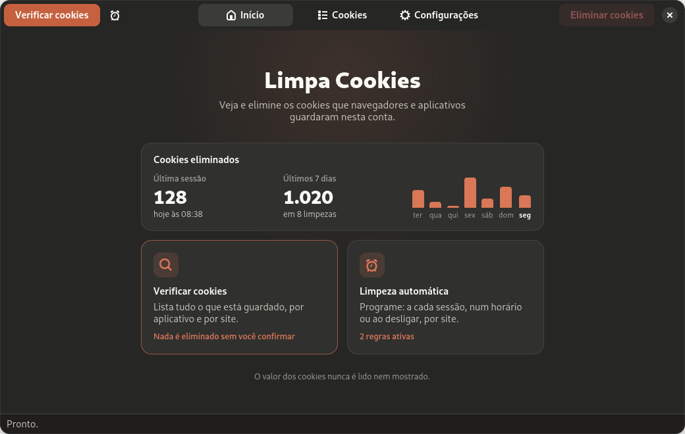
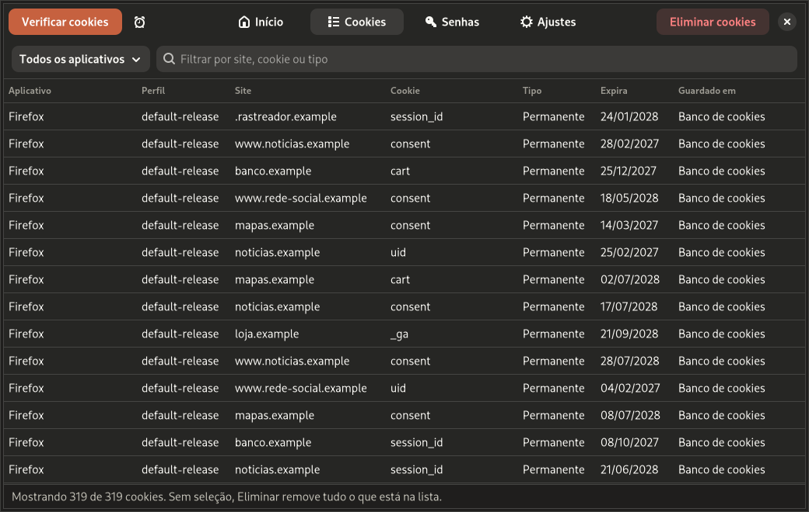
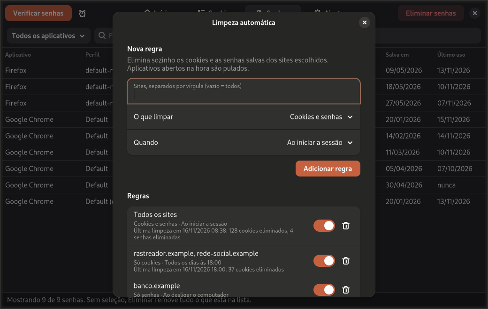
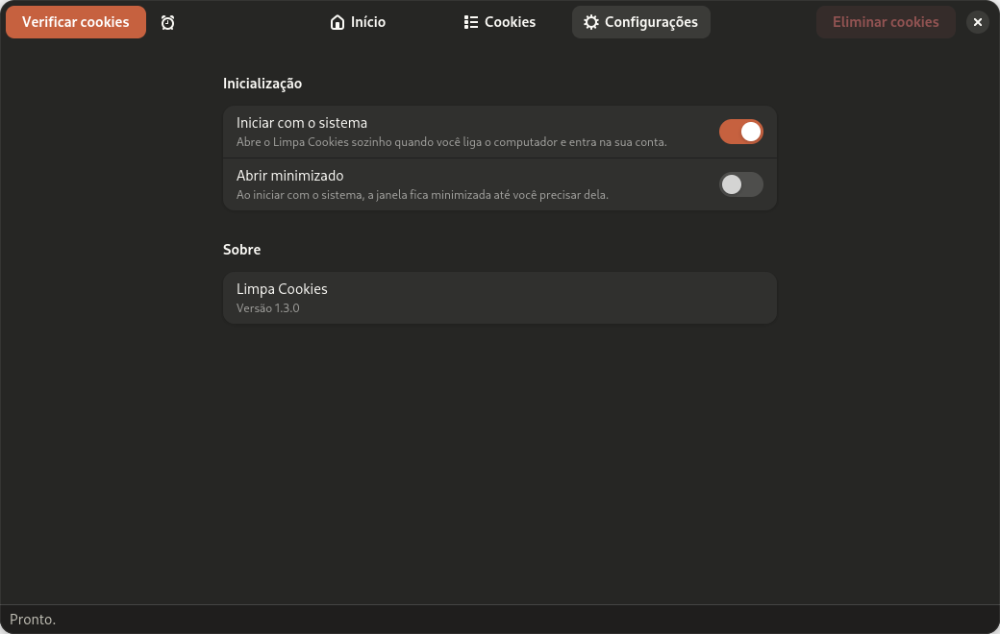

<p align="center">
  
</p>

<h1 align="center">Cooklean</h1>

<p align="center">
  <b>Limpa Cookies</b> para Linux e Windows: veja e elimine os cookies que navegadores
  e aplicativos guardaram na sua conta.
</p>

<p align="center">
  
</p>

O valor dos cookies **nunca é lido nem mostrado**, e nada sai do seu computador: o programa
não usa a internet. Ele só mostra de quem é cada cookie (aplicativo, perfil, site, nome,
tipo e validade) e apaga os que você escolher.

## O que ele faz

| Função | Como funciona |
| --- | --- |
| **Verificar cookies** | Lista tudo o que está guardado em disco, por aplicativo, perfil e site. Dá para filtrar por aplicativo, buscar por texto e ordenar por qualquer coluna. |
| **Eliminar cookies** | Apaga tudo, só o que está na lista filtrada ou só as linhas selecionadas. Sempre pede confirmação antes. |
| **Limpeza automática** | Regras que limpam sozinhas: de todos os sites ou só de alguns, ao iniciar a sessão, todos os dias num horário ou ao desligar o computador. |
| **Monitor de estatísticas** | Na tela inicial: quantos cookies foram eliminados na última sessão e nos últimos 7 dias, com um gráfico por dia. |
| **Iniciar com o sistema** | Opção para o programa abrir sozinho quando você entra na sua conta, minimizado se quiser. |

**Navegadores e aplicativos reconhecidos:** Firefox, LibreWolf, Zen, Waterfox, Thunderbird,
Google Chrome, Chromium, Brave, Microsoft Edge, Vivaldi, Opera e aplicativos feitos com
Electron (VS Code, Discord, Slack, Teams, Claude e outros). No Linux, também as versões
snap e flatpak.

## Instalação

### Linux (Debian, Ubuntu e derivados)

Baixe o arquivo `.deb` da [versão mais recente](../../releases/latest) e, na pasta onde
ele ficou, rode:

```bash
sudo apt install ./limpa-cookies_*_all.deb
```

Depois é só procurar **Limpa Cookies** no menu de aplicativos, ou rodar `limpa-cookies`.
Para remover: `sudo apt remove limpa-cookies`.

Outras formas, a partir do código (`git clone https://github.com/SeveXtz/Cooklean.git`):

- **Gerar o pacote você mesmo:** `./gerar_deb.sh` cria o `.deb` na pasta `dist`.
- **Sem senha de administrador:** `./instalar.sh` cria o atalho no menu só para o seu
  usuário (`./instalar.sh --remover` desfaz).
- **Sem instalar:** `python3 limpa_cookies.py`.

Precisa de Python 3.9 ou mais novo com GTK 4 e libadwaita 1.5 (Debian 13, Ubuntu 24.04).
Em sistemas mais antigos (Debian 12, Ubuntu 22.04) o programa abre uma janela mais
simples, que usa o `python3-tk`.

### Windows 10 e 11

Baixe um destes arquivos da [versão mais recente](../../releases/latest):

- `LimpaCookies-<versão>-Instalador.exe`: instala o programa e cria o atalho no menu
  Iniciar.
- `LimpaCookies.exe`: o programa completo num arquivo só, sem instalar. Basta abrir.

Não precisa de Python nem de senha de administrador. Como o programa não tem assinatura
digital, o Windows pode mostrar o aviso "O Windows protegeu o computador": clique em
**Mais informações** e depois em **Executar assim mesmo**.

<details>
<summary>Gerar o <code>.exe</code> você mesmo</summary>

1. Instale o [Python 3.9 ou mais novo](https://www.python.org/downloads/windows/).
2. Baixe este projeto em **Code → Download ZIP** e extraia a pasta.
3. Dê dois cliques em `windows\gerar_exe.bat`.

O resultado fica na pasta `dist`. O instalador só é gerado se o
[Inno Setup 6](https://jrsoftware.org/isdl.php) estiver instalado.

</details>

## Como usar

**1. Verifique.** Clique em **Verificar cookies**. A aba **Cookies** mostra tudo o que foi
encontrado; use o filtro por aplicativo e a busca para achar o que procura.

<p align="center">
  
</p>

**2. Elimine.** Selecione as linhas que quer apagar (ou nenhuma, para apagar tudo o que
está na lista) e clique em **Eliminar cookies**. Você será desconectado dos sites
correspondentes. Aplicativos abertos são pulados: feche o navegador e repita.

**3. Automatize.** Em **Limpeza automática**, escreva os sites (ou deixe vazio para
todos), escolha quando e clique em **Adicionar regra**. Cada regra pode ser desligada sem
ser apagada, e mostra quando rodou pela última vez.

<p align="center">
  
</p>

**4. Configure.** Na aba **Configurações**, ligue **Iniciar com o sistema** para o
programa abrir sozinho a cada início de sessão.

<p align="center">
  
</p>

As imagens são da janela do Linux, com cookies fictícios. No Windows as telas e funções
são as mesmas.

## Bom saber

- **A limpeza automática não deixa nada rodando em segundo plano.** Quem dispara as regras
  é o próprio sistema: autostart e systemd no Linux, registro e Agendador de Tarefas no
  Windows.
- **No Windows, "ao desligar" limpa no início seguinte**, porque o sistema não deixa um
  programa comum rodar durante o desligamento.
- **Eliminar não pode ser desfeito.** Os cookies são apagados de verdade do arquivo, não
  só marcados como removidos.
- **Regras, configurações e estatísticas** ficam em `~/.config/limpa-cookies` no Linux e
  em `%APPDATA%\LimpaCookies` no Windows.

## Linha de comando

| Comando | O que faz |
| --- | --- |
| `limpa_cookies.py` | Abre a janela. |
| `limpa_cookies.py --resumo` | Imprime só a contagem de cookies por aplicativo. |
| `limpa_cookies.py --minimizado` | Abre a janela minimizada. |
| `limpa_cookies.py --tk` | No Linux, abre a janela simples (a mesma do Windows). |
| `limpa_cookies.py --home PASTA` | Usa `PASTA` no lugar da pasta pessoal, para testes. |
